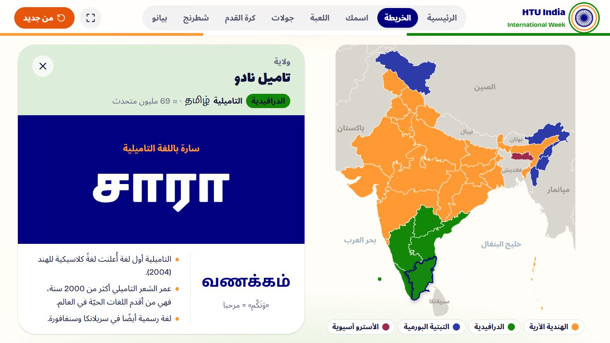
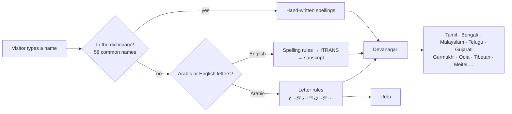
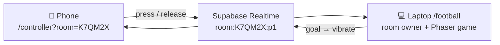

<div align="center">


# India Speaks · الهند تتحدّث

**An interactive booth website that shows visitors how many languages India speaks.** Live at **https://htuindia.lol**.
Built for the India booth at **HTU International Week** (Al Hussein Technical University, Jordan).

<p dir="rtl"><b>موقع تفاعلي يعرّف زوّار جناح الهند بتنوّع لغات الهند وخطوطها: اكتب اسمك وشاهده بخطوط هندية، استكشف خريطة اللغات، والعب «خمّن الخط»!</b></p>


-000080)

</div>

---

## 📸 Screenshots

| Home | Your Name |
| :---: | :---: |
|  |  |
| **Language map** | **Attract mode (idle screen)** |
|  |  |

## ✨ What visitors can do

A guide stands next to the laptop and walks each visitor through it in 1–2 minutes. Every screen gives them something to *do*, not text to read.

| Page | What happens |
| --- | --- |
| 🏠 **Home** | Animated counters (22 official languages · 120+ major languages · 19,500+ mother tongues), the 17 languages on Indian banknotes, and **"You already know some Hindi!"**: Hindi words that are also Arabic (किताब = كتاب). Hover a card to see it in Urdu. |
| ✍️ **Your Name** | Type a name in Arabic or English and see it in **Hindi, Urdu, Tamil, Bengali and Malayalam**. Tap a card to see how the name is built letter by letter, press **"Watch it being written"** to see each letter traced, and **"Take a photo!"** for a full-screen souvenir card. |
| 🗺️ **Map** | India's 36 states and union territories coloured by language family, with neighbouring countries in gray. Hover a state for "Hello" in its language; click it to see **the visitor's own name in that state's script** (Telugu, Gujarati, Tibetan, Meitei Mayek…). |
| 🎮 **Game** | "Guess the Script": 5 quick rounds; pick which of four words is written in, say, Tamil. Speed bonus and today's high score. |
| 🥋 **India Fighters** | A side-view fighting game on the laptop, **controlled with the visitor's own phone** (no app: scan a QR code, the phone becomes a gamepad). Two original fighters, Veer and Tara, fight in a palace courtyard at sunset: best of 3, special moves, a beatable CPU opponent, and the phone vibrates when you get hit. |
| 🧭 **Virtual tours** | Walk through real **360° photos** of **Sanchi Stupa** (around all four gates), the **Gateway of India**, the **Ajanta** and **Ellora** caves, **Hyderabad** from the sky and the **Udayagiri Caves**. The visitor's phone becomes a two-stick gamepad: walk with the left stick, look around with the right, plus zoom, facts and next place. Works offline; optional Google Street View. |
| 🎹 **Raga Tiles** | A piano-tiles game played on visitors' **own phones** (the laptop only shows a QR code at `/tiles-qr`). Synthesized piano, rangoli-style tiles, Easy / Normal, best scores per phone. Songs come from MIDI files (`npm run song`); the National Anthem plays in a respectful mode that can never be interrupted. The phone page is a separate ~110 KB bundle that works offline once loaded. |
| ♟️ **India & Chess** | Chess was born in India: a countdown to Gukesh's title match, Chaturanga pieces that morph into today's pieces (Sanskrit / Arabic / English names), the journey to Persia, the Arab world and Europe, and a **15-level Puzzle Challenge** for laptop or phone (QR code), with lives, a "Grandmaster!" ending and today's leaderboard. Every puzzle is machine-verified at build time. |
| 💤 **Attract mode** | After 30 s without input, a full-screen Indian-flag loop says "Hello" in many Indian scripts until someone touches the laptop. |

## 🚀 Quick start

You need [Node.js](https://nodejs.org/) 20.19 or newer (22 LTS recommended).

```bash
git clone https://github.com/Mralwahsh/Indian-languages-website.git
cd Indian-languages-website
npm install
copy .env.example .env.local   # then fill in the Supabase keys (optional for a first look)
npm run dev                    # http://localhost:5173
```

| Command | What it does |
| --- | --- |
| `npm run dev` | Development with live reload (http://localhost:5173), reachable from phones on the same network. |
| `npm run build` | Verify the chess puzzles, then build the static site into `dist/` (what Vercel runs). |
| `npm start` | Build + serve the production version locally (http://localhost:4173). |
| `npm run sim` | Plays hundreds of fights with the real game engine to check the balance (no browser needed). |

**Deploying?** [DEPLOY.md](DEPLOY.md): Supabase project, Vercel, environment variables, the `htuindia.lol` domain.
**At the booth?** [BOOTH_SETUP.md](BOOTH_SETUP.md): the morning checklist, each feature, troubleshooting.

Fonts, map data and the HarfBuzz engine are all inside the project (no font or map services). Visitors' phones use their own
mobile data; only the phone-controller games need a live connection (Supabase Realtime). The last fully-offline version
(laptop server + Windows hotspot) is the git tag `local-hotspot-version`.

## 🎪 At the booth

| Control | What it does |
| --- | --- |
| **⛶** button | Fullscreen. |
| **من جديد** button or **Esc** | New visitor: clears the name and everything else, back to Home. In fullscreen, a short Esc press resets; *holding* Esc exits fullscreen (Chrome / Edge). |
| No input for 30 s | Attract mode starts. Any input closes it. If it keeps running for 90 more seconds, the previous visitor's name is wiped. |
| Game keys **1 – 4**, **Enter** | Answer / start: handy for the guide. |
| Fight page: **A D W S + J K L I**, **P**, **M** | Play P1 on the keyboard, show ping, sound on/off. |

Timings are in [`src/config/booth.js`](src/config/booth.js).

**Before the event**

- [ ] Open https://htuindia.lol and click through every page
- [ ] Follow the morning checklist in [BOOTH_SETUP.md](BOOTH_SETUP.md) and play one match with a phone on mobile data
- [ ] Use Chrome or Edge, browser zoom 100 %, fullscreen on
- [ ] Turn off sleep / screensaver and keep the charger connected

## 🛠️ Tech stack

| | |
| --- | --- |
| Framework | React 19 + Vite, React Router |
| Hosting | Vercel (static site, no server code) |
| Realtime | Supabase Realtime: Broadcast + Presence, one channel per 6-character room code (phone controllers) |
| Game | Phaser 3, with a separate pure-JS fight engine |
| Styling | Tailwind CSS 4, Framer Motion animations, right-to-left Arabic layout |
| Map | d3-geo + topojson-client |
| Scripts | [`@indic-transliteration/sanscript`](https://github.com/indic-transliteration/sanscript.js) for transliteration, [HarfBuzz](https://github.com/harfbuzz/harfbuzzjs) (WebAssembly) for real glyph shapes |
| Fonts | Self-hosted Noto fonts for 14 scripts + Noto Kufi / Noto Sans Arabic for the interface |

## ⚙️ How it works

### From a name to five scripts (offline, no AI yet)



- Names from rules get an **"≈ تهجئة تقريبية"** (approximate spelling) badge.
- Devanagari is the hub: every other Indic script is generated from it, with script-specific fixes (Tamil ன/ஃப, Gurmukhi ੱ, Malayalam chillu letters, Meitei final letters, Bengali য়).
- A simple Hindi "schwa deletion" rule turns अहमद into the pronunciation *ah-mad*.

### Phones as game controllers



- There is no server of our own: the **laptop page owns the room** (who is Player 1 / Player 2, characters, phase, score) and the phones only send **button presses and releases** (with the full "held" state, so a lost message repairs itself). Each player has its own channel, so phones never receive each other's input. See [`src/game/net/footballProtocol.js`](src/game/net/footballProtocol.js).
- A new room code after every game; the QR on the laptop carries it. Supabase's free plan allows ~100 messages/s; a match uses ~30–45.
- The game reads every player through the same **InputSource** interface (phone, keyboard or CPU), so it never knows where input comes from.
- The fight logic (`src/game/engine/`) is plain JavaScript with no Phaser, running at a fixed 60 steps per second. That's why `npm run sim` can test it in Node.
- A phone that drops (screen lock, lost signal) pauses the match and gets **its own slot back** when it reconnects.

### Real letter shapes

Indian scripts join and reorder letters (ि is written *before* the consonant it follows; ब + ् + र becomes ब्र). Instead of faking this, the site runs **HarfBuzz**, the same text-shaping engine browsers use, on the bundled Noto fonts and draws every glyph as an SVG path. That's what makes two features possible:

- **Letter breakdown:** each part of a syllable is coloured *inside* the real glyph as it's explained.
- **Handwriting animation:** each glyph's outline is traced and then filled.

## 📁 Project structure

```
legacy-local-server/  the old offline booth server (reference only, see its README)
shared/          protocol.js (slots, buttons, characters), nicknames.js
public/
  data/          india_states.topojson (state borders), neighbors.topojson (gray countries)
  fonts/         Noto .ttf files, used by CSS and by HarfBuzz
src/
  tour/          virtual tours: places, config (feel), providers (offline photos / Google Street View), stick → step logic
  pages/         HomePage, MapPage, NamePage, GamePage, FightPage (laptop), ControllerPage (phone)
  components/    TopBar, AttractMode, GlyphText, LetterBreakdown, StatePanel, fight/ (lobby, stage, QR)…
  game/
    characters/  one config file per fighter (colours, sprite paths, move stats) + README
    engine/      Fighter + Match: pure fight simulation
    input/       InputSource: Keyboard, Network (phone), CPU
    phaser/      FightScene, stage, fighter views, HUD
  services/      dataService (all data access) · transliteration · glyphService (HarfBuzz) · scriptInfo
  data/          languages, states, names, arabicWords, gameRounds (.json)
  realtime/      Supabase Realtime channels (+ a same-browser test mode), room codes, message counters
  config/        site.js (QR addresses), booth.js (timings), scripts, nameScripts
scripts/         simulate-fights.mjs (npm run sim)
```

## ✏️ Editing the content

All texts shown to visitors are plain JSON in [`src/data/`](src/data). No code changes needed:

| To change… | Edit |
| --- | --- |
| Language facts, greetings, speaker numbers | [`languages.json`](src/data/languages.json) |
| State names and facts | [`states.json`](src/data/states.json) |
| Names and their spellings (add a `"malayalam"` field to override the generated one) | [`names.json`](src/data/names.json) |
| Hindi ⇄ Arabic word cards | [`arabicWords.json`](src/data/arabicWords.json) |
| Game words | [`gameRounds.json`](src/data/gameRounds.json) |
| Fighters, moves, damage, real sprite art | [`src/game/characters/`](src/game/characters) ([guide](src/game/characters/README.md)) |
| Tour places, facts, walking directions | [`src/tour/places.js`](src/tour/places.js) (photos in `public/tours/`) |
| Tour controls feel (look speed, dead zone, walk interval) | [`src/tour/config.js`](src/tour/config.js) |
| CPU difficulty, round length | [`src/game/config.js`](src/game/config.js) |

## 🧭 Roadmap

- **India Fighters, Phase 2**: two phones fight each other (the server already has P1/P2 slots).

The code is ready for AI spellings (**Supabase Edge Function + OpenRouter**):

- `transliterateName()` is already `async`: swap its body for a call to a Supabase Edge Function that asks OpenRouter for any name.
- Every `get…()` function in `dataService.js` returns the same shape as the JSON files, so they can read from Supabase tables instead.
- 🔒 Secret API keys (OpenRouter, Supabase service role) stay in the Edge Function: never in the frontend. Only the public Supabase anon key and the referrer-restricted Maps key ship in the page.

## ✅ To verify before the event

<details>
<summary>Spellings and facts that need a check by native speakers (click to open)</summary>

**Names and words**
- [ ] All 58 names in `names.json` (Hindi, Urdu, Tamil, Bengali + pronunciation)
- [ ] Malayalam names (generated automatically from the Hindi spelling)
- [ ] The 12 word cards in `arabicWords.json` and the 8 game words × 10 languages in `gameRounds.json`
- [ ] Arabic letter choices in `src/services/arabicMapping.js` (ث→स, ذ/ض/ظ→ज़, ص→स, ط→त, ع)
- [ ] Letter-breakdown explanations in `src/services/scriptInfo.js`

**Arabic text**
- [ ] All interface text, translated facts, and Arabic names of states and languages (`nameAr`)
- [ ] Greetings written in Arabic letters (`helloPronunciationAr`, e.g. नमस्ते → «نَمَستي»)
- [ ] Map labels for countries and seas (`LABELS` in `src/pages/MapPage.jsx`)

**Greetings**
- [ ] Kashmiri «آداب» · Santali ᱡᱚᱦᱟᱨ · Manipuri ꯈꯨꯔꯨꯝꯖꯔꯤ · Ladakhi ཇུ་ལེ · Khasi "Kumno" · Nagamese "Kineka ase?"

**Facts and numbers**
- [ ] Home counters (22 · 120+ · 19,500+) and banknotes (17 languages)
- [ ] Speaker numbers in `languages.json` (Census 2011, rounded)
- [ ] Every fact marked `TODO: verify` in `languages.json` and `states.json`

</details>

## 🙏 Credits

- **Map data:** [DataMeet](https://github.com/datameet/maps) state boundaries (CC BY 2.5 India) and [Natural Earth](https://www.naturalearthdata.com/) countries with India's point of view (public domain).
- **Fonts:** [Noto](https://notofonts.github.io/) and [Bricolage Grotesque](https://fontsource.org/fonts/bricolage-grotesque) (SIL Open Font License).
- **Numbers:** Census of India 2011.
- **360° tour photos** (Wikimedia Commons): Photo Dharma (CC BY 2.0: Sanchi, Ajanta, Ellora, Udayagiri; cropped below 50° down to remove the watermark), Fuzheado (CC BY-SA 4.0: Gateway of India, Taj Mahal Palace hotel), iMahesh (CC BY-SA 4.0: Hyderabad). Each photo's source link is in [`src/tour/places.js`](src/tour/places.js); the credit line is also shown in the tour's info card.
- **Chess pieces:** Colin M.L. Burnett (Cburnett), CC BY-SA 3.0, via Wikimedia Commons. **Rules:** [chess.js](https://github.com/jhlywa/chess.js) (BSD-2-Clause).
- **360° viewer:** [Photo Sphere Viewer](https://photo-sphere-viewer.js.org/) (MIT).

<div align="center">

Made with 🧡🤍💚 by the India team · HTU International Week

</div>
# HTU-India-website

