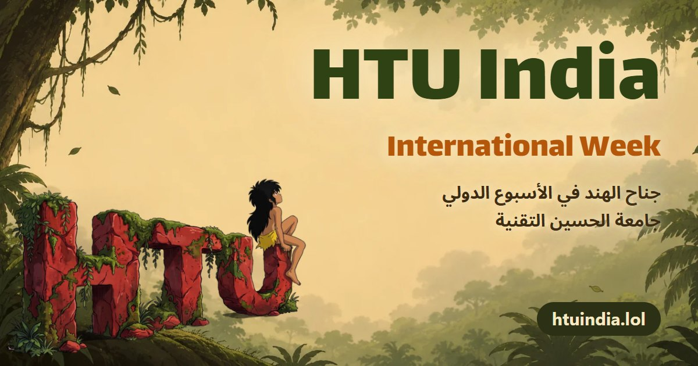
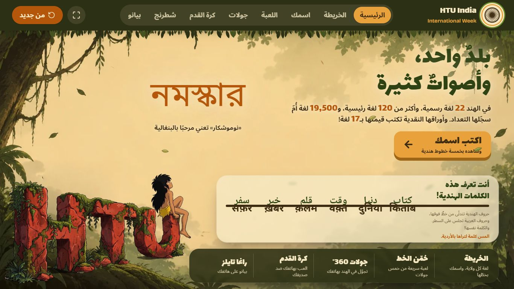
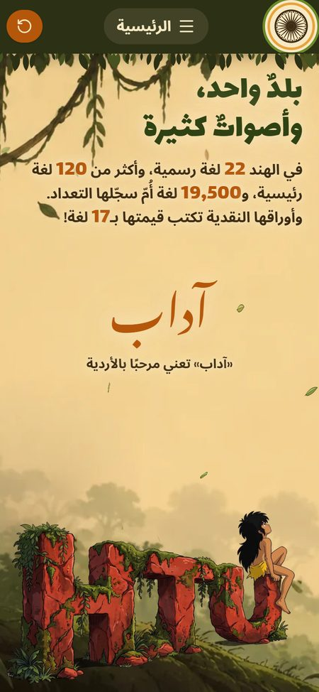
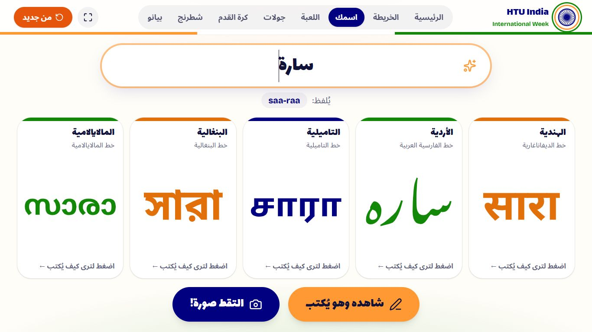
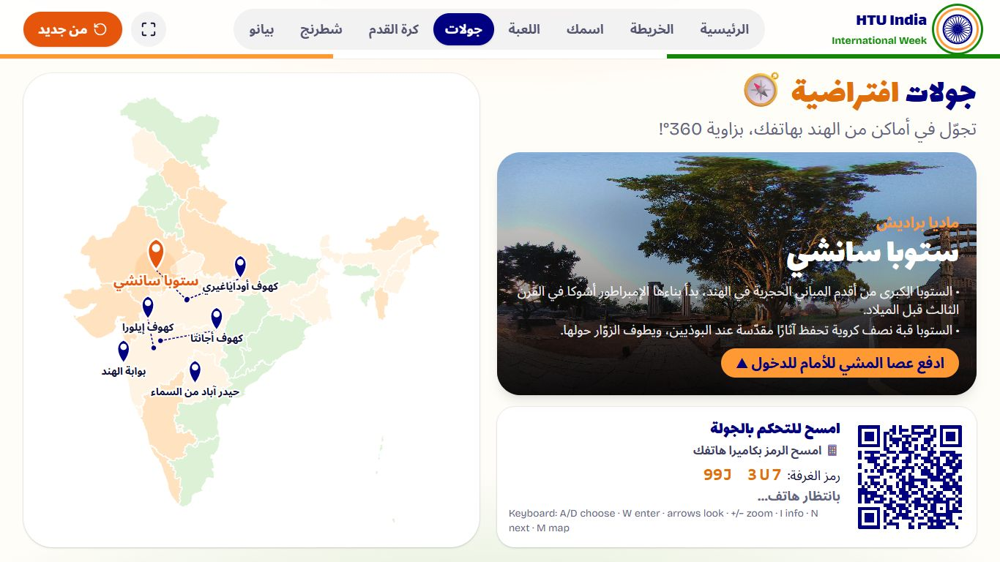
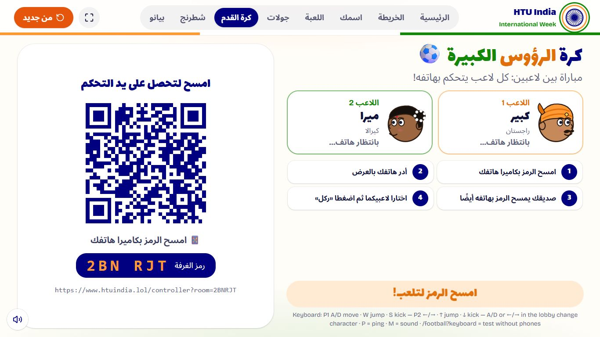
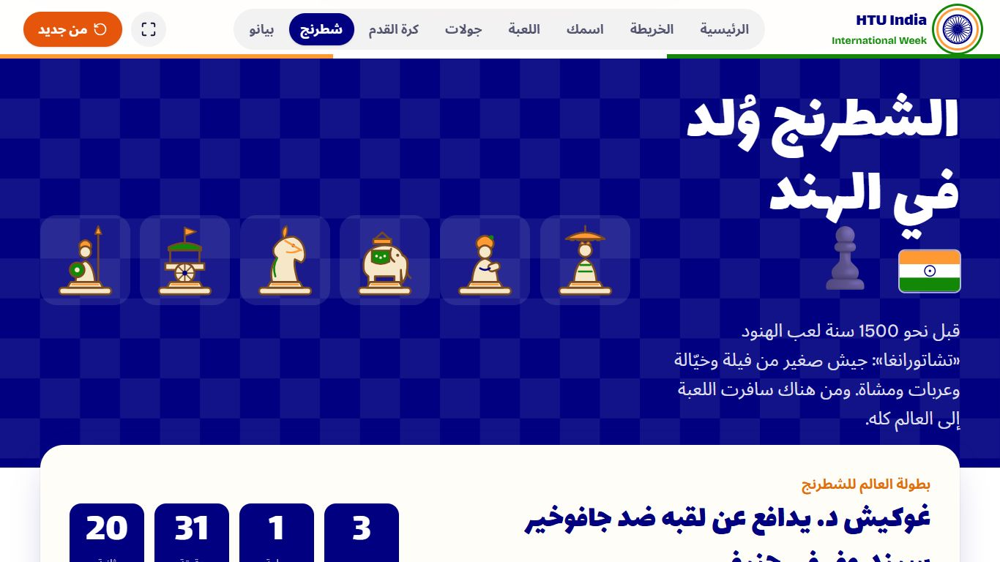
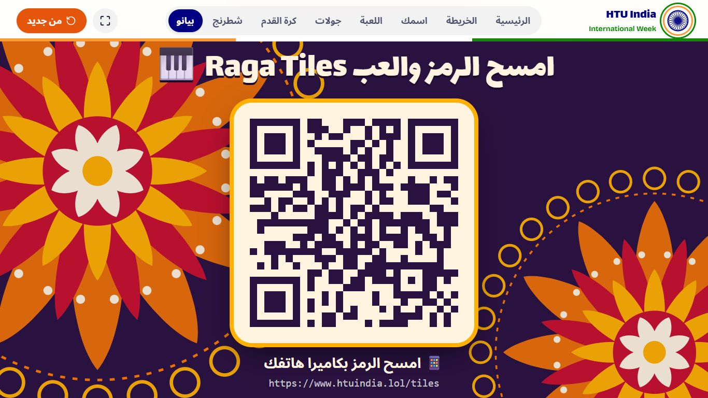
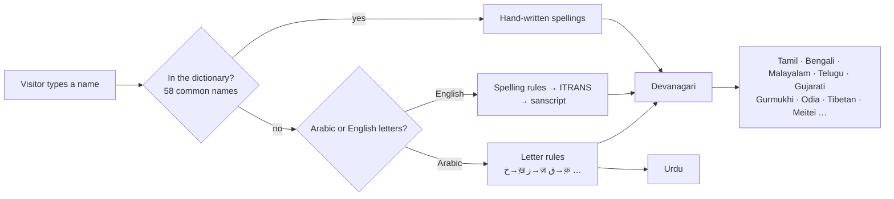
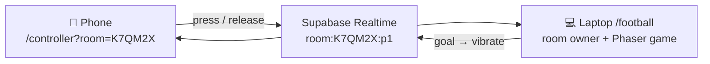

<div align="center">



# HTU India · International Week

**The India booth website for HTU International Week** (Al Hussein Technical University, Jordan).
Live at **https://htuindia.lol**.

<p dir="rtl"><b>موقع جناح الهند في الأسبوع الدولي بجامعة الحسين التقنية: «بلدٌ واحد، وأصواتٌ كثيرة». اكتب اسمك وشاهده بخطوط هندية، استكشف خريطة اللغات، تجوّل في الهند بزاوية 360°، والعب بهاتفك!</b></p>


-e9a23b)

</div>

---

## 🌿 The new home page

The home page is a **misty Indian forest**. In the bottom-left corner a boy sits on giant mossy **HTU** letters,
swinging his legs and looking up at a "hello" that changes language every few seconds. Leaves drift down through the
scene, and the top bar becomes the forest canopy. On phones the forest is the first screen and everything else
follows below it.

| Laptop | Phone |
| :---: | :---: |
|  |  |

## 📸 The other pages

| ✍️ Your Name | 🗺️ Language map |
| :---: | :---: |
|  |  |
| **🧭 360° tours** | **⚽ Big Head Football** |
|  |  |
| **♟️ India & Chess** | **🎹 Raga Tiles** |
|  |  |

## ✨ What visitors can do

A guide stands next to the laptop and walks each visitor through it in 1–2 minutes. Every screen gives them something
to *do*, not text to read.

| Page | What happens |
| --- | --- |
| 🌿 **Home** | The forest scene with the boy on the HTU letters. **"One country, many voices"**: 22 official languages, 120+ major languages, 19,500 mother tongues, and 17 languages on every banknote. A big "hello" in a different Indian language every few seconds, with how to say it. **"You already know these Hindi words!"**: the same word in Arabic sits *on* a line and in Hindi hangs *from* it (كتاب = किताब); tap one to see it in Urdu. |
| ✍️ **Your Name** | Type a name in Arabic or English and see it in **Hindi, Urdu, Tamil, Bengali and Malayalam**. Tap a card to see how the name is built letter by letter, press **"Watch it being written"** to see each letter traced, and **"Take a photo!"** for a full-screen souvenir card. |
| 🗺️ **Map** | India's 36 states and union territories coloured by language family, with neighbouring countries in gray. Hover a state for "Hello" in its language; click it to see **the visitor's own name in that state's script** (Telugu, Gujarati, Tibetan, Meitei Mayek…). |
| 🎮 **Guess the Script** | 5 quick rounds: pick which of four words is written in, say, Tamil. Speed bonus and today's high score. |
| 🧭 **360° tours** | Walk through real **360° photos** of **Sanchi Stupa** (around all four gates), the **Gateway of India**, the **Ajanta** and **Ellora** caves, **Hyderabad** from the sky and the **Udayagiri Caves**. The visitor's phone becomes a two-stick gamepad: walk with the left stick, look around with the right, plus zoom, facts, a **"all places"** button and next place (one phone at a time; others wait their turn). |
| ⚽ **Big Head Football** | A football match on the laptop for **two players, each controlling with their own phone** (no app: scan the QR code and the phone becomes a gamepad). Pick one of four players (Arjun, Kabir, Meera, Tara); left / right / jump / kick, 90 seconds, and Android phones vibrate on a goal. A match only starts once both phones are connected. Today's records: matches played, biggest win, most goals. |
| 🎹 **Raga Tiles** | A piano-tiles game played on visitors' **own phones** (the laptop only shows a QR code at `/tiles-qr`). Synthesized piano, rangoli-style tiles, Easy / Normal, best scores per phone. Songs come from MIDI files (`npm run song`); the National Anthem plays in a respectful mode that can never be interrupted. The phone page is a separate ~110 KB bundle that works offline once loaded. |
| ♟️ **India & Chess** | Chess was born in India: a countdown to Gukesh's title match, Chaturanga pieces that morph into today's pieces (Sanskrit / Arabic / English names), the journey to Persia, the Arab world and Europe, and a **15-level Puzzle Challenge** for laptop or phone (QR code), with lives and a "Grandmaster!" ending. Every puzzle is machine-verified at build time. |
| 💤 **Attract mode** | After 30 s without input, a full-screen loop says "Hello" in many Indian scripts until someone touches the laptop. |

Every page also works on phones: the page buttons fold into a **☰** menu and the pages scroll.

## 🚀 Quick start

You need [Node.js](https://nodejs.org/) 20.19 or newer (22 LTS recommended).

```bash
git clone https://github.com/Mralwahsh/HTU-India-website.git
cd HTU-India-website
npm install
copy .env.example .env.local   # then fill in the Supabase keys (optional for a first look)
npm run dev                    # http://localhost:5173
```

| Command | What it does |
| --- | --- |
| `npm run dev` | Development with live reload (http://localhost:5173), reachable from phones on the same network. |
| `npm run build` | Verify the chess puzzles, then build the static site into `dist/` (what Vercel runs). |
| `npm start` | Build + serve the production version locally (http://localhost:4173). |
| `npm run lint` | Check the code with oxlint. |
| `npm run song` | Turn a MIDI file into a Raga Tiles song. |
| `npm run puzzles` | Check every chess puzzle (`puzzles:generate` and `puzzles:pgn` make new ones). |

**Deploying?** [DEPLOY.md](DEPLOY.md): Supabase project, Vercel, environment variables, the `htuindia.lol` domain,
and getting the site on Google.
**At the booth?** [BOOTH_SETUP.md](BOOTH_SETUP.md): the morning checklist, each feature, troubleshooting.

Fonts, map data and the HarfBuzz engine are all inside the project (no font or map services). Visitors' phones use
their own mobile data; only the phone-controller games need a live connection (Supabase Realtime). The last
fully-offline version (laptop server + Windows hotspot) is the git tag `local-hotspot-version`.

## 🎪 At the booth

| Control | What it does |
| --- | --- |
| **⛶** button | Fullscreen. |
| **من جديد** button or **Esc** | New visitor: clears the name and everything else, back to Home. In fullscreen, a short Esc press resets; *holding* Esc exits fullscreen (Chrome / Edge). |
| No input for 30 s | Attract mode starts. Any input closes it. If it keeps running for 90 more seconds, the previous visitor's name is wiped. |
| Game keys **1 – 4**, **Enter** | Answer / start: handy for the guide. |
| Football: **P**, **M** | Show ping, sound on / off. `/football?keyboard` plays without phones, for testing (P1: A D W S, P2: arrow keys). |
| Tours: **A D**, **W**, arrows, **+ −**, **I**, **N**, **M** | Choose a place, enter, look around, zoom, facts, next place, back to the map. |

Timings are in [`src/config/booth.js`](src/config/booth.js).

**Before the event**

- [ ] Open https://htuindia.lol and click through every page
- [ ] Follow the morning checklist in [BOOTH_SETUP.md](BOOTH_SETUP.md) and play one match with two phones on mobile data
- [ ] Use Chrome or Edge, browser zoom 100 %, fullscreen on
- [ ] Turn off sleep / screensaver and keep the charger connected

## 🛠️ Tech stack

| | |
| --- | --- |
| Framework | React 19 + Vite 8, React Router |
| Hosting | Vercel (static site, no server code) |
| Realtime | Supabase Realtime: Broadcast + Presence, one channel per 6-character room code (phone controllers) |
| Football | Phaser 3 with Matter physics |
| Styling | Tailwind CSS 4, Framer Motion animations, right-to-left Arabic layout |
| Home scene | A see-through looping video drawn with WebGL, falling leaves in pure CSS |
| Map | d3-geo + topojson-client |
| 360° tours | Photo Sphere Viewer |
| Scripts | [`@indic-transliteration/sanscript`](https://github.com/indic-transliteration/sanscript.js) for transliteration, [HarfBuzz](https://github.com/harfbuzz/harfbuzzjs) (WebAssembly) for real glyph shapes |
| Fonts | Self-hosted Noto fonts for 14 scripts, Lalezar for headlines, Noto Sans Arabic and Bricolage Grotesque for text |

## ⚙️ How it works

### From a name to five scripts (offline, no AI yet)



- Names from rules get an **"≈ تهجئة تقريبية"** (approximate spelling) badge.
- Devanagari is the hub: every other Indic script is generated from it, with script-specific fixes (Tamil ன/ஃப, Gurmukhi ੱ, Malayalam chillu letters, Meitei final letters, Bengali য়).
- A simple Hindi "schwa deletion" rule turns अहमद into the pronunciation *ah-mad*.

### Phones as game controllers



- There is no server of our own: the **laptop page owns the room** (who is Player 1 / Player 2, characters, phase, score) and the phones only send **button presses and releases** (with the full "held" state, so a lost message repairs itself). Each player has its own channel, so phones never receive each other's input. See [`src/game/net/footballProtocol.js`](src/game/net/footballProtocol.js).
- A new room code after every game; the QR on the laptop carries it. Supabase's free plan allows ~100 messages/s; a match uses ~30–45.
- The game reads every player through the same **InputSource** interface (phone or keyboard), so it never knows where input comes from.
- A phone that drops (screen lock, lost signal) pauses the match and gets **its own slot back** when it reconnects.
- The 360° tours work the same way, with one phone at a time (`src/tour/net/`).

### Real letter shapes

Indian scripts join and reorder letters (ि is written *before* the consonant it follows; ब + ् + र becomes ब्र). Instead
of faking this, the site runs **HarfBuzz**, the same text-shaping engine browsers use, on the bundled Noto fonts and draws
every glyph as an SVG path. That's what makes two features possible:

- **Letter breakdown:** each part of a syllable is coloured *inside* the real glyph as it's explained.
- **Handwriting animation:** each glyph's outline is traced and then filled.

### The boy on the HTU letters

The animation is a short AI-made clip, looped forward and back so it never jumps. Its white background was cut out frame
by frame. The result is a **"stacked alpha" MP4**: the picture in the top half, its transparency as grey in the bottom
half. A small WebGL canvas ([`AlphaVideo.jsx`](src/components/AlphaVideo.jsx)) puts the two halves back together on
every frame, so the boy stands on the forest with soft shadows in every browser, Safari included. With "reduce motion"
turned on, or without WebGL, a still picture is shown instead.

### Found on Google

Each page has its own title and description in **English and Arabic** ("HTU India", "International Week HTU India", …),
listed in [`src/config/seo.js`](src/config/seo.js). The build writes a small HTML file per page with those tags and a
link-preview picture ([`public/og-image.jpg`](public/og-image.jpg)), plus `sitemap.xml`. `robots.txt` keeps the phone
controllers out of search results. Adding the site to Google Search Console is in [DEPLOY.md](DEPLOY.md#6-getting-found-on-google).

## 📁 Project structure

```
legacy-local-server/  the old offline booth server (reference only, see its README)
shared/          protocol.js (slots, buttons, characters), tourProtocol.js, nicknames.js
public/
  home/          forest.webp, htu-boy-alpha.mp4 (the see-through loop), htu-boy-still.webp
  data/          india_states.topojson (state borders), neighbors.topojson (gray countries)
  fonts/         Noto .ttf files, used by CSS and by HarfBuzz
  tours/         360° photos · songs/  Raga Tiles songs · puzzles/  chess puzzles
  og-image.jpg   the link-preview picture · robots.txt
src/
  pages/         HomePage, MapPage, NamePage, GamePage, TourPage, FootballPage, ChessPage, TilesQrPage,
                 ControllerPage + TourControllerPage (phones)
  components/    TopBar, AlphaVideo, FallingLeaves, SeoTags, AttractMode, GlyphText, LetterBreakdown,
                 StatePanel, football/, tour/, chess/, tiles/
  game/
    football/    Phaser scene, players, stadium, HUD, today's records, config.js (every tuning value),
                 characters/ (one file per player)
    input/       InputSource: keyboard, phone (Supabase)
    net/         the football room: host (laptop), client (phone), protocol
  tour/          places, controls feel, photo providers (offline / Google Street View), net/ (room)
  tiles/         Raga Tiles (its own small page, tiles.html)
  chess-puzzles/ the Puzzle Challenge (its own small page, chess-puzzles.html)
  realtime/      Supabase Realtime channels (+ a same-browser test mode), room codes, message counters
  services/      dataService (all data access) · transliteration · glyphService (HarfBuzz) · scriptInfo
  data/          languages, states, names, arabicWords, gameRounds (.json)
  config/        seo.js (titles for Google), site.js (QR addresses), booth.js (timings), chess.js, scripts
scripts/         puzzle checks and generators, MIDI → song
```

## ✏️ Editing the content

Most texts shown to visitors are plain JSON in [`src/data/`](src/data). No code changes needed:

| To change… | Edit |
| --- | --- |
| Language facts, greetings, speaker numbers | [`languages.json`](src/data/languages.json) |
| State names and facts | [`states.json`](src/data/states.json) |
| Names and their spellings (add a `"malayalam"` field to override the generated one) | [`names.json`](src/data/names.json) |
| Hindi ⇄ Arabic words (the home page shows six of them: `WORD_IDS` in `HomePage.jsx`) | [`arabicWords.json`](src/data/arabicWords.json) |
| Game words | [`gameRounds.json`](src/data/gameRounds.json) |
| Home page numbers, greeting order, activities | [`src/pages/HomePage.jsx`](src/pages/HomePage.jsx) (top of the file) |
| Home page forest, video and still | [`public/home/`](public/home) |
| Titles and descriptions on Google and in link previews | [`src/config/seo.js`](src/config/seo.js) |
| Football players | [`src/game/football/characters/`](src/game/football/characters) |
| Football feel (match length, ball, jumps, kicks) | [`src/game/football/config.js`](src/game/football/config.js) |
| Tour places, facts, walking directions | [`src/tour/places.js`](src/tour/places.js) (photos in `public/tours/`) |
| Tour controls feel (look speed, dead zone, walk interval) | [`src/tour/config.js`](src/tour/config.js) |

## 🧭 Roadmap

- **Chess leaderboard on Supabase:** today's top solvers still come from the old laptop server, so on Vercel the leaderboard shows "الخادم غير متصل" (server not connected).

The code is ready for AI spellings (**Supabase Edge Function + OpenRouter**):

- `transliterateName()` is already `async`: swap its body for a call to a Supabase Edge Function that asks OpenRouter for any name.
- Every `get…()` function in `dataService.js` returns the same shape as the JSON files, so they can read from Supabase tables instead.
- 🔒 Secret API keys (OpenRouter, Supabase service role) stay in the Edge Function: never in the frontend. Only the public Supabase anon key and the referrer-restricted Maps key ship in the page.

## ✅ To verify before the event

<details>
<summary>Spellings and facts that need a check by native speakers (click to open)</summary>

**Names and words**
- [ ] All 58 names in `names.json` (Hindi, Urdu, Tamil, Bengali + pronunciation)
- [ ] Malayalam names (generated automatically from the Hindi spelling)
- [ ] The 12 word cards in `arabicWords.json` and the 8 game words × 10 languages in `gameRounds.json`
- [ ] Arabic letter choices in `src/services/arabicMapping.js` (ث→स, ذ/ض/ظ→ज़, ص→स, ط→त, ع)
- [ ] Letter-breakdown explanations in `src/services/scriptInfo.js`

**Arabic text**
- [ ] All interface text, translated facts, and Arabic names of states and languages (`nameAr`)
- [ ] Greetings written in Arabic letters (`helloPronunciationAr`, e.g. नमस्ते → «نَمَستي»)
- [ ] Map labels for countries and seas (`LABELS` in `src/pages/MapPage.jsx`)

**Greetings**
- [ ] Kashmiri «آداب» · Santali ᱡᱚᱦᱟᱨ · Manipuri ꯈꯨꯔꯨꯝꯖꯔꯤ · Ladakhi ཇུ་ལེ · Khasi "Kumno" · Nagamese "Kineka ase?"

**Facts and numbers**
- [ ] Home numbers (22 · 120+ · 19,500) and banknotes (17 languages)
- [ ] Speaker numbers in `languages.json` (Census 2011, rounded)
- [ ] Every fact marked `TODO: verify` in `languages.json` and `states.json`

</details>

## 🙏 Credits

- **Map data:** [DataMeet](https://github.com/datameet/maps) state boundaries (CC BY 2.5 India) and [Natural Earth](https://www.naturalearthdata.com/) countries with India's point of view (public domain).
- **Fonts:** [Noto](https://notofonts.github.io/), [Lalezar](https://fontsource.org/fonts/lalezar) and [Bricolage Grotesque](https://fontsource.org/fonts/bricolage-grotesque) (SIL Open Font License).
- **Numbers:** Census of India 2011.
- **Home page:** the animation of the boy on the HTU letters was made with Kling AI; the forest background is a picture the team provided (with the painted boy removed).
- **360° tour photos** (Wikimedia Commons): Photo Dharma (CC BY 2.0: Sanchi, Ajanta, Ellora, Udayagiri; cropped below 50° down to remove the watermark), Fuzheado (CC BY-SA 4.0: Gateway of India, Taj Mahal Palace hotel), iMahesh (CC BY-SA 4.0: Hyderabad). Each photo's source link is in [`src/tour/places.js`](src/tour/places.js); the credit line is also shown in the tour's info card.
- **Chess pieces:** Colin M.L. Burnett (Cburnett), CC BY-SA 3.0, via Wikimedia Commons. **Rules:** [chess.js](https://github.com/jhlywa/chess.js) (BSD-2-Clause).
- **360° viewer:** [Photo Sphere Viewer](https://photo-sphere-viewer.js.org/) (MIT).

<div align="center">

🌿 Made with 🧡🤍💚 by the India team · HTU International Week 🌿

</div>
